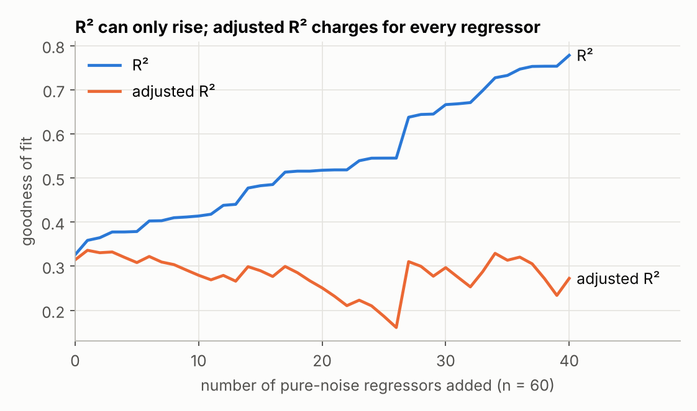
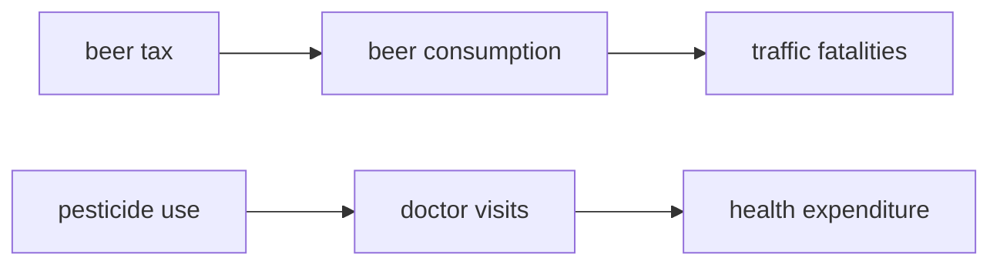
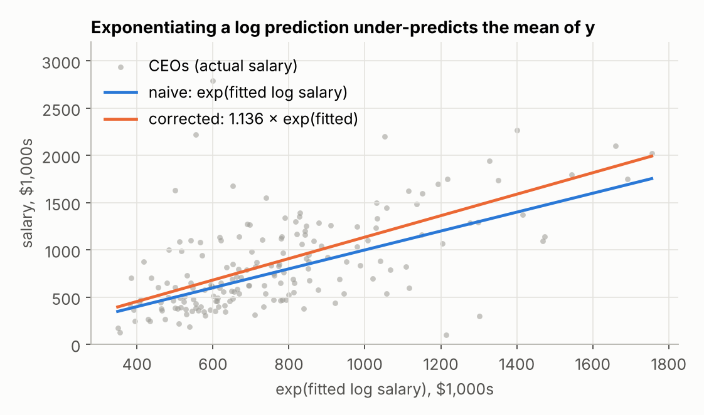
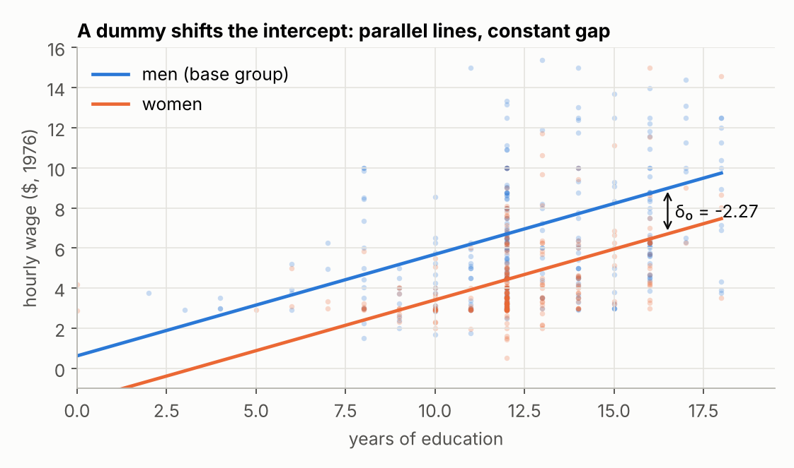
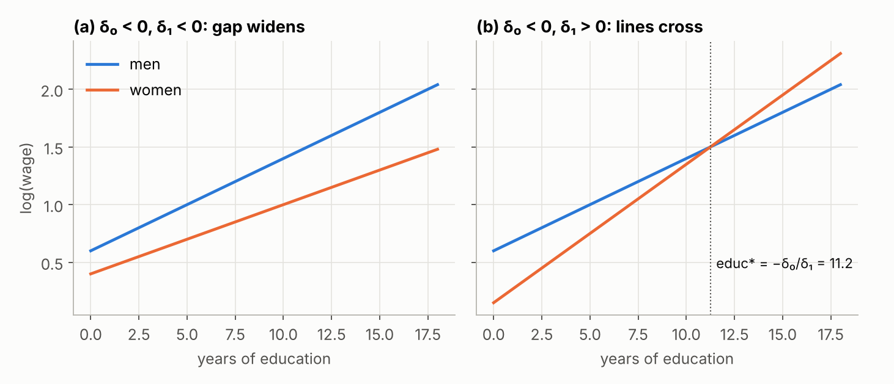
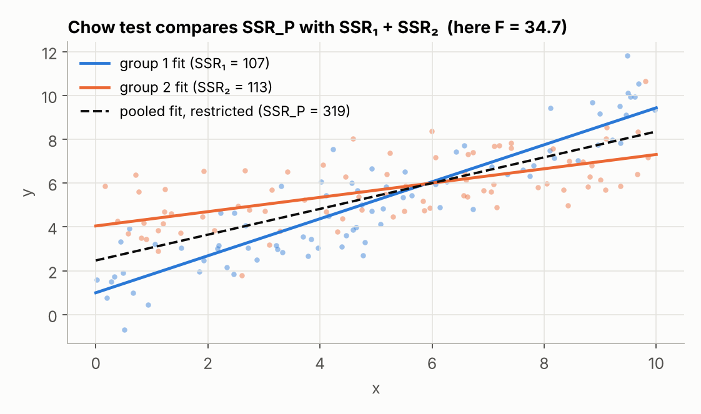
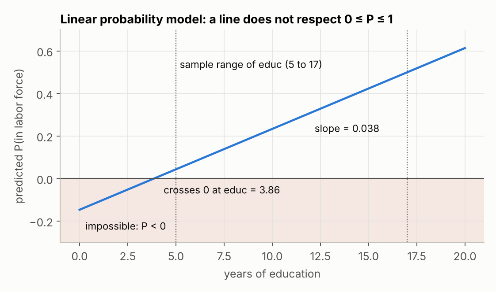
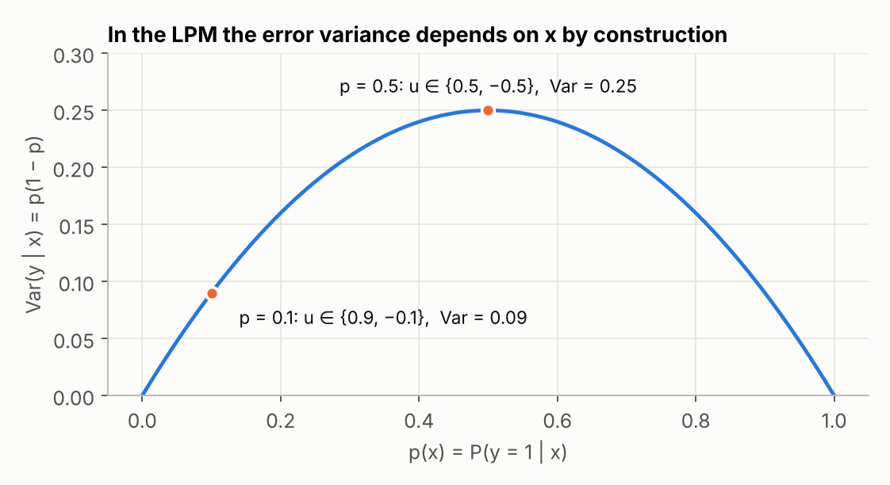

# Ch. 6 (part 2) & Ch. 7 — Model Selection, Dummy Variables, and the Linear Probability Model

Review notes for an undergraduate econometrics course taught from Wooldridge, *Introductory Econometrics: A Modern Approach*. The notes follow the lecture slides (Oct 27 and Oct 29 sessions) and are checked against the textbook chapter. Every estimate quoted below is reproduced by [`code/replicate.py`](code/replicate.py); every figure is generated by [`code/make_figures.py`](code/make_figures.py).

| | |
|---|---|
| **Scope** | Ch. 6.3–6.4 (goodness of fit, choice of regressors, prediction with a log dependent variable) and Ch. 7 (qualitative information) |
| **Data** | `wage1`, `rdchem`, `ceosal1`, `ceosal2`, `gpa3`, `mroz`, `jtrain` from the [`wooldridge`](https://pypi.org/project/wooldridge/) Python package |
| **Reproduce** | `pip install wooldridge statsmodels matplotlib` → `python code/replicate.py` → `python code/make_figures.py` |

**Contents**

- [Part A — Chapter 6: fit, controls, prediction](#part-a--chapter-6-fit-controls-prediction)
- [Part B — Chapter 7: qualitative information](#part-b--chapter-7-qualitative-information)
- [Common mistakes](#common-mistakes)
- [Replication check](#replication-check)

---

## Part A — Chapter 6: fit, controls, prediction

### A1. Average partial effects

With quadratics or interactions, the effect of $x_1$ on $y$ is not one number: it depends on where you evaluate it. The **average partial effect (APE)** summarizes it in two steps: compute the partial effect, then average it over the sample.

| Model | Partial effect of $x_1$ | APE |
|---|---|---|
| $y=\beta_0+\beta_1x_1+\beta_2x_2+\beta_3x_1x_2+u$ | $\beta_1+\beta_3x_2$ | $\hat\beta_1+\hat\beta_3\bar x_2$ |
| $y=\beta_0+\beta_1x_1+\beta_2x_1^2+u$ | $\beta_1+2\beta_2x_1$ | $\hat\beta_1+2\hat\beta_2\bar x_1$ |

### A2. What R-squared does and does not say

$R^2$ is the share of sample variation in $y$ that the regressors explain. Two things it does **not** tell you:

- **Causality.** A high $R^2$ does not make the coefficients causal, and a low $R^2$ does not rule causality out.
- **Precision.** A low $R^2$ is compatible with precisely estimated partial effects.

### A3. Adjusted R-squared

Writing $R^2 = 1-\dfrac{SSR/n}{SST/n}$ shows that it estimates the population quantity $1-\sigma_u^2/\sigma_y^2$ with biased variance estimators. Replacing them with the degrees-of-freedom-corrected versions gives

```math
\bar R^2 \;=\; 1-\frac{SSR/(n-k-1)}{SST/(n-1)} \;=\; 1-(1-R^2)\,\frac{n-1}{n-k-1}.
```

Properties worth remembering:

1. **Penalty for regressors.** $R^2$ never falls when a variable is added. $\bar R^2$ can fall, because $n-k-1$ shrinks too.
2. **The $|t|>1$ rule.** Adding one regressor raises $\bar R^2$ if and only if its $t$ statistic exceeds 1 in absolute value (for a group: $F>1$). That is a weaker bar than statistical significance.
3. **It can be negative.** With $R^2=.10$, $n=51$, $k=10$: $\bar R^2 = 1-.90(50)/40=-.125$.
4. **$F$ statistics use $R^2$, not $\bar R^2$.**



*Simulation: one real regressor plus up to 40 columns of pure noise. $R^2$ climbs to almost .8 on noise alone. Lecture version of the same point: regress birth weight across countries on 10,000 stock prices and some of them will correlate with it by chance.*

### A4. Choosing between nonnested models

Two models are **nested** when one is a special case of the other (set some coefficients to zero); an $F$ test compares them. They are **nonnested** when neither is a special case of the other, and the $F$ test does not apply. $\bar R^2$ gives a fair comparison when the models have different numbers of parameters **and the same dependent variable**.

R&D intensity on firm sales (`rdchem`, $n=32$):

| Model | Parameters | $R^2$ | $\bar R^2$ |
|---|---|---|---|
| $rdintens=\beta_0+\beta_1\log(sales)+u$ | 2 | .061 | .030 |
| $rdintens=\beta_0+\beta_1sales+\beta_2sales^2+u$ | 3 | .148 | **.090** |

The quadratic still wins after paying for its extra parameter.

### A5. Never compare fit across different dependent variables

$R^2$ and $\bar R^2$ measure explained variation *in whatever sits on the left-hand side*. Changing $y$ to $\log(y)$ changes the amount of variation there is to explain.

CEO salary (`ceosal1`, $n=209$):

| Dependent variable | $R^2$ | $SST$ |
|---|---|---|
| $salary$ | .029 | 391,732,982 |
| $\log(salary)$ | .282 | 66.72 |

The log model's higher $R^2$ is not evidence that it fits better. A valid comparison is in [A8](#a8-predicting-y-when-the-model-is-for-logy).

### A6. Over-controlling

Adding controls is not always safer. If a variable lies **on the path** from the regressor of interest to the outcome, holding it fixed removes the effect you set out to measure.



| Question | Do **not** control for | Why |
|---|---|---|
| Effect of state beer taxes on traffic fatalities | beer consumption | The tax works *through* consumption |
| Effect of pesticide use on family health expenditure | doctor visits | Doctor visits are part of the expenditure |
| Value of an extra bedroom in a house price regression | assessed price | It holds one measure of value fixed while asking about another |

The purpose of the regression decides the specification. Assessed price *does* belong in the model if the question is whether assessments predict sale prices well. Chasing a higher $\bar R^2$ (.762 with the assessment, .630 without) would give the wrong model for valuing housing attributes.

### A7. Adding regressors to reduce the error variance

```math
\operatorname{Var}(\hat\beta_j)=\frac{\sigma^2}{SST_j\,(1-R_j^2)}
```

A new regressor pulls in two directions: it can raise $R_j^2$ (multicollinearity, larger variance) and it lowers $\sigma^2$ (smaller variance). The clear case is a variable that **affects $y$ but is uncorrelated with the regressor of interest**: $R_j^2$ stays put, $\sigma^2$ falls, the standard error falls. The motive is precision, not bias.

- Individual beer demand on county beer price: add age and education.
- A randomized experiment: add session fixed effects. Random assignment makes them uncorrelated with treatment, yet they explain outcomes.

Such variables are rare outside experiments.

### A8. Predicting y when the model is for log(y)

From $\log(y)=\beta_0+\beta_1x_1+\dots+\beta_kx_k+u$ we get $y=\exp(\beta_0+\dots+\beta_kx_k)\exp(u)$. If $u$ is independent of the regressors,

```math
E(y\mid \mathbf x)=\alpha_0\exp(\beta_0+\beta_1x_1+\dots+\beta_kx_k),\qquad \alpha_0=E[\exp(u)]>1 .
```

So the obvious prediction $\exp(\widehat{\log y})$ is **too low on average**. The fix is to scale it:

```math
\hat y=\hat\alpha_0\exp(\widehat{\log y}),\qquad \hat\alpha_0=\frac1n\sum_{i=1}^n\exp(\hat u_i)\quad\text{(smearing estimate)}.
```

$\hat\alpha_0$ is **consistent but biased**: residuals replace errors inside a nonlinear function. If we knew the bias $b$ of an estimator we would subtract it and be done; usually we do not, so consistency is the property we settle for.



*CEO salaries (`ceosal2`): $\hat\alpha_0=1.136$, so the naive prediction is about 14% too low.*

To compare this model with a levels model, use the squared correlation between $y$ and $\hat y$ as its $R^2$ for $y$.

---

## Part B — Chapter 7: qualitative information

### B1. A single dummy regressor: intercept shift

A **dummy (binary) variable** equals 1 for one group and 0 for the other. Name it after the group coded 1 (`female`, not `gender`).

```math
wage=\beta_0+\delta_0\,female+\beta_1\,educ+u,\qquad
\delta_0=E(wage\mid female=1,educ)-E(wage\mid female=0,educ).
```

Men have intercept $\beta_0$, women $\beta_0+\delta_0$, and both share slope $\beta_1$: two parallel lines, with a gap that does not change with education.



*`wage1`, controlling for education only. With experience and tenure added the gap is −1.81 (see below).*

### B2. The dummy variable trap

Including `female`, `male` **and** an intercept is impossible: $female+male=1$ reproduces the constant, which is perfect collinearity.

- For $g$ groups use an intercept and $g-1$ dummies. The omitted group is the **base group**, and every dummy coefficient is a difference from it.
- Switching the base group changes interpretation, not fit ($\gamma_0=-\delta_0$ in the two-group case).
- Dropping the intercept and keeping all $g$ dummies also avoids the trap, but group differences become awkward to test and the usual $R^2$ is no longer well defined. It is rarely done in applied work.

### B3. Reading the estimates

Hourly wage (`wage1`, $n=526$):

| Specification | Coefficient on `female` | SE | Meaning |
|---|---|---|---|
| `female` only | −2.51 | .30 | Difference in mean wages; the regression is a two-sample $t$ test |
| + `educ`, `exper`, `tenure` | −1.81 | .26 | Gap at equal education, experience and tenure |

The gap shrinks with controls because part of the raw difference reflects differences in those characteristics. A significant −1.81 is still **not proof of discrimination**: other productivity-related factors correlated with gender may be missing.

**Program evaluation.** In `jtrain`, firms that received a training grant trained each worker 26.25 hours more ($t=4.70$). Whether that is causal depends on how grants were assigned. If firms that were keen on training anyway were also the ones that obtained grants, the coefficient mixes the two.

### B4. Dummies when the dependent variable is log(y)

The coefficient times 100 is approximately the percentage difference. Housing prices (`hprice1`): the coefficient on `colonial` is .054, so a colonial-style house sells for about 5.4% more, other things equal. (A dummy has no "percentage change" of its own; the comparison is 0 versus 1.)

For large coefficients use the exact formula:

```math
\%\Delta\hat y = 100\,[\exp(\hat\beta_1)-1].
```

A coefficient of −.297 on `female` in a log wage equation is −25.7% exactly, not −29.7%.

### B5. More than two categories

Four groups by gender and marital status, base group **single men** (`wage1`, log wage, controls for education, experience and tenure):

| Group | Coefficient | Reading |
|---|---|---|
| married men | .213 | about 21.3% above single men |
| married women | −.198 | about 19.8% below single men |
| single women | −.110 | about 11.0% below single men |

Differences between two non-base groups are differences of coefficients (single vs married women: $-.110-(-.198)=.088$), but testing them needs a re-estimation with one of them as the base.

### B6. Ordinal information

A credit rating $CR\in\{0,1,2,3,4\}$ carries order, not distance. Entering $CR$ linearly forces every one-step improvement to have the same effect. A dummy per rating does not:

```math
MBR=\beta_0+\delta_1CR_1+\delta_2CR_2+\delta_3CR_3+\delta_4CR_4+\text{other factors},
```

with rating 0 as the base. The linear model is the special case $\delta_2=2\delta_1,\ \delta_3=3\delta_1,\ \delta_4=4\delta_1$, testable with an $F$ test ($q=3$).

### B7. Interacting a dummy with a continuous regressor: different slopes

```math
\log(wage)=\beta_0+\delta_0\,female+\beta_1\,educ+\delta_1\,female\cdot educ+u
```

| | Intercept | Slope on `educ` |
|---|---|---|
| Men | $\beta_0$ | $\beta_1$ |
| Women | $\beta_0+\delta_0$ | $\beta_1+\delta_1$ |

- $H_0:\delta_1=0$ — same return to education ($t$ test).
- $H_0:\delta_0=0,\ \delta_1=0$ — same wage equation ($F$ test).



**Why an insignificant dummy can mislead.** Adding the interaction to the log wage equation gives (`wage1`):

| Term | Coefficient | SE | $t$ |
|---|---|---|---|
| `female` | −.227 | .168 | −1.35 |
| `female·educ` | −.0056 | .0131 | −0.43 |

Neither is individually significant, yet the joint test gives $F=34.33$. Two things are going on:

1. `female` and `female·educ` are highly correlated, which inflates the standard error on `female` from .036 to .168. Collinearity hides the effect.
2. With the interaction present, $\delta_0$ is the gap **at `educ = 0`**, a point with almost no data.

Re-centering fixes the second problem: replace `female·educ` with `female·(educ − 12.5)`. The coefficient on `female` becomes the gap at average education, −.296 with SE .036, and nothing else changes.

### B8. Testing whether two groups share a regression function: the Chow test

**Unrestricted model** (full set of interactions), college GPA for athletes (`gpa3`, spring term, $n=366$):

```math
cumgpa=\beta_0+\delta_0 female+\beta_1 sat+\delta_1 female\cdot sat+\beta_2 hsperc+\delta_2 female\cdot hsperc+\beta_3 tothrs+\delta_3 female\cdot tothrs+u
```

**Null hypothesis** $H_0:\delta_0=\delta_1=\delta_2=\delta_3=0$, under which the model collapses to the **restricted model** with one regression for everyone. Under $H_0$ both models are true; the test asks whether the simpler one is enough.

None of the four `female` terms is individually significant. The joint test is what matters.

**Chow's shortcut.** The unrestricted SSR equals the sum of the SSRs from separate regressions on each group, so no interactions need to be built:

```math
F=\frac{\left[SSR_P-(SSR_1+SSR_2)\right]/(k+1)}{(SSR_1+SSR_2)/\left[n-2(k+1)\right]}
```

| Regression | Sample | SSR |
|---|---|---|
| Pooled (restricted) | all 366 | $SSR_P=85.515$ |
| Group 1 | 90 women | $SSR_1=19.603$ |
| Group 2 | 276 men | $SSR_2=58.752$ |

```math
F=\frac{(85.515-78.355)/4}{78.355/358}\approx 8.18\quad\Rightarrow\quad\text{reject }H_0.
```



*Simulated illustration: the pooled line fits both clouds badly, so $SSR_P$ is far above $SSR_1+SSR_2$.*

Two caveats:

- The Chow test is an $F$ test, so it assumes **equal error variances** in the two groups.
- The basic version allows no difference at all. To allow different intercepts and test slopes only, keep the group dummy in the restricted model and test the $k$ interactions. In the GPA example that test has $p=.205$: the groups differ in intercept, not in slopes.

### B9. A binary dependent variable: the linear probability model

When $y\in\{0,1\}$, $E(y\mid\mathbf x)=P(y=1\mid\mathbf x)$, so the regression line is a probability:

```math
P(y=1\mid\mathbf x)=\beta_0+\beta_1x_1+\dots+\beta_kx_k,\qquad \Delta P(y=1\mid\mathbf x)=\beta_j\,\Delta x_j .
```

Each coefficient is the change in the probability of "success" for a one-unit change in $x_j$.

Labor force participation of married women (`mroz`, $n=753$): one more year of education raises the probability by .038; one more child under six lowers it by .262.

**Three problems**

1. **Predicted probabilities outside $[0,1]$.** In this sample 16 fitted values are below 0 and 17 are above 1.
2. **Impossible marginal effects.** A constant effect per unit cannot hold everywhere: four young children would lower the probability by $4\times.262=1.048$.
3. **Heteroskedasticity by construction.** See below.



*Fitted probability against education with the other regressors fixed (`nwifeinc = 50`, `exper = 5`, `age = 30`, `kidslt6 = 1`, `kidsge6 = 0`). "No one in the sample is out there" is a practical defence, not a theoretical one.*

**Why the error is heteroskedastic.** For a given $\mathbf x$ the error takes only two values: $u=1-p(\mathbf x)$ when $y=1$ and $u=-p(\mathbf x)$ when $y=0$. Using $\operatorname{Var}(Y)=E(Y^2)-[E(Y)]^2$ and the fact that $Y^2=Y$ for a 0/1 variable:

```math
E(Y)=P(Y=1),\quad E(Y^2)=P(Y=1)\ \Longrightarrow\ \operatorname{Var}(y\mid\mathbf x)=p(\mathbf x)\,[1-p(\mathbf x)].
```

The variance changes with $\mathbf x$ unless the probability does not depend on $\mathbf x$ at all.



OLS coefficients remain unbiased, but the usual standard errors, $t$ and $F$ statistics are not valid. Report **heteroskedasticity-robust standard errors** (HC1 in `replicate.py`).

**Why it is still used.** It is easy to estimate and interpret, and near the centre of the data its estimates are usually close to those from nonlinear alternatives (logit, probit).

### B10. Policy analysis and self-selection

Scrap rates on a training grant (`jtrain`, 1988, $n=50$): the coefficient on `grant` is −.052 with SE .431. No detectable effect. But grants went out first come, first served, which is not random. If struggling firms applied more eagerly, a variable like "firm in trouble" sits in the error term, is correlated with `grant`, and biases the estimate. This is **omitted variable bias**, and more controls are the first line of defence when assignment is not random.

**Self-selection** is the same problem seen from the unit's side: people, firms or cities choose whether to participate, so participation is correlated with unobservables. Parents decide whether a child joins Head Start; family background affects both the decision and the outcome.

**Potential outcomes.** Let $w$ be the treatment dummy, $y(0)$ the outcome without treatment and $y(1)$ the outcome with it, so $y=(1-w)\,y(0)+w\,y(1)$.

| Regression | Identifying assumption | What $\hat\tau$ is |
|---|---|---|
| $y=\alpha+\tau w+u$ | $w$ independent of $[y(0),y(1)]$: random assignment | difference in means |
| $y=\alpha+\tau w+\gamma_1x_1+\dots+\gamma_kx_k+u$ | independence **conditional on** $x_1,\dots,x_k$ | restricted regression adjustment (RRA): one effect for everyone |
| $y_i=\alpha+\tau w_i+\mathbf x_i\boldsymbol\gamma+w_i(\mathbf x_i-\bar{\mathbf x})\boldsymbol\delta+u_i$ | same | unrestricted regression adjustment (URA): effects vary with $\mathbf x$ |

In the URA model the effect of treatment for unit $i$ is $\tau+(\mathbf x_i-\bar{\mathbf x})\boldsymbol\delta$. Centering the covariates at their sample means makes the interaction vanish on average, so the coefficient on $w$ **is the average treatment effect (ATE)**.

An equivalent route: fit separate regressions on the control and treated groups, predict $\hat y_i^{(0)}$ and $\hat y_i^{(1)}$ for every unit, and average the difference,

```math
\widehat{ATE}=\frac1n\sum_{i=1}^n\left[\hat y_i^{(1)}-\hat y_i^{(0)}\right].
```

It gives the same number, but the standard error is harder to get by hand. Which covariates to include depends on how units end up treated; if the relevant ones are unobserved, regression adjustment does not remove the bias.

---

## Common mistakes

| Mistake | Correction |
|---|---|
| Reading a high $R^2$ as evidence of causality or of precise estimates | $R^2$ speaks to neither |
| Comparing $R^2$ between a $y$ model and a $\log(y)$ model | Different dependent variables, different $SST$ |
| Controlling for a variable that transmits the effect | Leave mediators out unless the indirect effect is the question |
| Using $\exp(\widehat{\log y})$ as the prediction of $y$ | Multiply by $\hat\alpha_0>1$ |
| Including a dummy for every group plus an intercept | $g-1$ dummies; the omitted group is the base |
| Calling a dummy coefficient discrimination or a causal effect | Ask what correlated factors are uncontrolled and how treatment was assigned |
| Concluding "no gap" from an insignificant dummy when its interaction is in the model | The dummy measures the gap at zero; re-center and use the joint $F$ test |
| Judging a joint hypothesis from individual $t$ statistics | Use the $F$ (Chow) test |
| Reporting usual OLS standard errors for an LPM | The LPM is heteroskedastic; use robust standard errors |
| Treating the Chow test under $H_0$ as "only the restricted model is true" | Under $H_0$ both models are true |

## Replication check

Output of `code/replicate.py` against the textbook values.

| Result | Textbook | Replicated |
|---|---|---|
| $\bar R^2$, log vs quadratic R&D models | .030 / .090 | .030 / .090 |
| $SST$ for `salary` / `log(salary)` | 391,732,982 / 66.72 | 391,732,982 / 66.72 |
| Smearing estimate $\hat\alpha_0$ | 1.136 | 1.136 |
| `female`, wage equation with controls | −1.81 (.26) | −1.811 (.265) |
| `female`, difference in means | −2.51 (.30) | −2.512 (.303) |
| `marrmale` / `marrfem` / `singfem` | .213 / −.198 / −.110 | .213 / −.198 / −.110 |
| `female`, `female·educ` | −.227 (.168), −.0056 (.0131) | −.227 (.168), −.0056 (.0131) |
| Joint $F$ for the two `female` terms | 34.33 | 34.33 |
| Chow $F$, GPA example | 8.18 | 8.18 |
| Slopes-only test, $p$-value | .205 | .205 |
| LPM: `educ` / `kidslt6` | .038 / −.262 | .038 / −.262 |
| LPM fitted values below 0 / above 1 | 16 / 17 | 16 / 17 |
| `grant` on training hours | 26.25 (5.59) | 26.25 (5.59) |
| `grant` on log scrap rate | −.052 (.431) | −.052 (.431) |

## Next

Chapter 8 picks up where the LPM leaves off: what heteroskedasticity does to OLS inference, robust (HC) standard errors, and when a more efficient estimator exists.

---

*Source: J. M. Wooldridge,* Introductory Econometrics: A Modern Approach*. Explanations are written in my own words from lecture slides and class notes; examples and data sets are the textbook's.*
