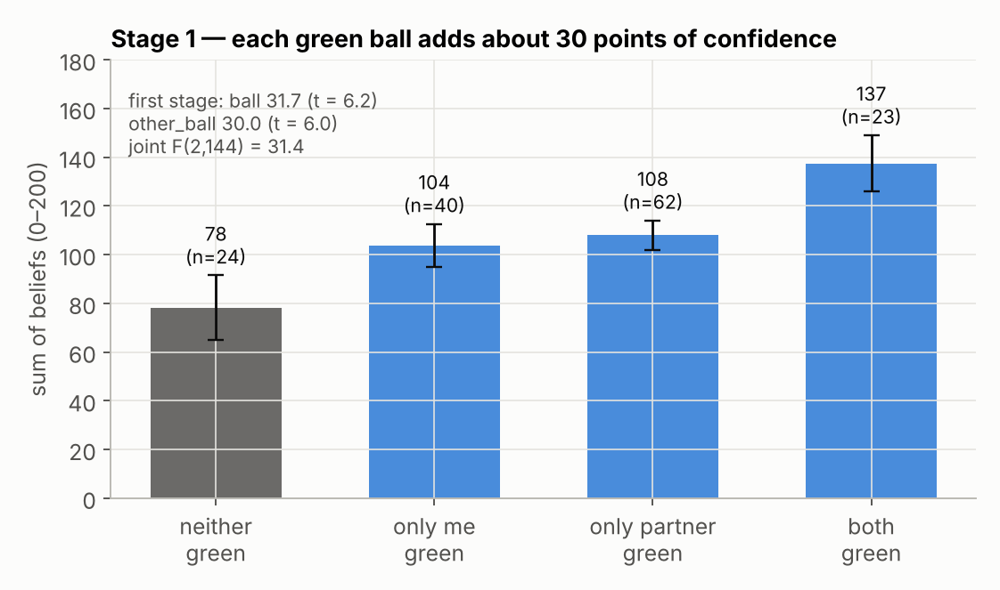
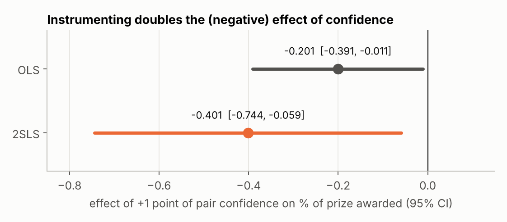
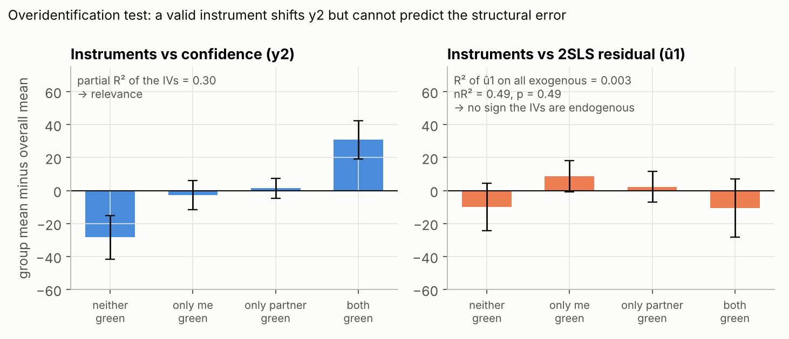
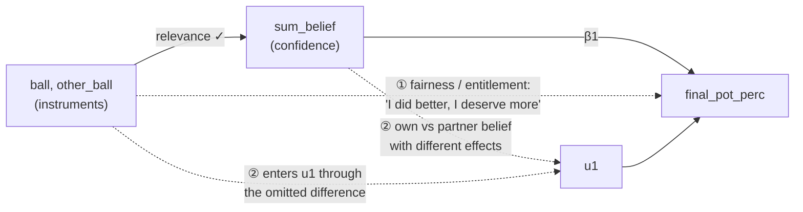

# Lab — Does confidence shrink the pie? IV/2SLS with experimental data

Applied companion to the [Chapter 15 notes](../README.md). In class (Nov 12) we re-estimated the main result of a published experiment with instrumental variables, in R, and then asked whether the instruments are actually valid.

> Soldà, A., Ke, C., von Hippel, W., & Page, L. (2021). Absolute versus relative success: Why overconfidence creates an inefficient equilibrium. *Psychological Science, 32*(10), 1662–1674. [doi:10.1177/09567976211007414](https://doi.org/10.1177/09567976211007414) — open access (CC BY), open data on [OSF](https://osf.io/km8c9/).

Reading notes on the paper itself are in [`PAPER.md`](PAPER.md).

| | |
|---|---|
| **Question** | When both negotiators are more confident, how much of a jointly earned prize is lost to delay and failed agreement? |
| **Target** | Table 2, Model 1 of the paper: $\hat\beta = -0.401$, constant $111.20$, $n = 149$ pairs |
| **Result** | Reproduced exactly in R and in Python (19 / 19 checks, see [Replication check](#8-replication-check)) |
| **Run it** | `Rscript code/iv_lab.R` (from `code/`) · or `pip install -r requirements.txt` → `python code/replicate.py` → `python code/make_figures.py` |

```
lab-overconfidence/
├── README.md               ← this walkthrough
├── PAPER.md                ← reading notes on Soldà et al. (2021)
├── requirements.txt        ← Python packages
├── data/instruments.csv    ← one row per negotiating pair (n = 149)
├── code/
│   ├── iv_lab.R            ← the class script, cleaned and extended
│   ├── replicate.py        ← Python re-estimation + checks against paper and R
│   └── make_figures.py     ← figures below
├── figures/                ← 3 PNGs
└── output/iv_lab_R_output.txt   ← full R console output
```

**Contents**

1. [The setting](#1-the-setting)
2. [Why OLS is not enough](#2-why-ols-is-not-enough)
3. [Stage 1: are the instruments relevant?](#3-stage-1-are-the-instruments-relevant)
4. [Stage 2: the 2SLS estimate](#4-stage-2-the-2sls-estimate)
5. [Do not trust the manual standard errors](#5-do-not-trust-the-manual-standard-errors)
6. [Diagnostics: Sargan and Wu-Hausman](#6-diagnostics-sargan-and-wu-hausman)
7. [Are the instruments really exogenous?](#7-are-the-instruments-really-exogenous)
8. [Replication check](#8-replication-check)
9. [How to talk about these results](#9-how-to-talk-about-these-results)

---

## 1. The setting

Pairs of students answer a quiz together and earn a joint prize. The prize is then split into an unequal 70/30 pair of shares, and the two must agree who takes the large share. If they take too long, **the prize starts shrinking** and can fall to zero.

Before negotiating, each participant sees a **noisy signal** about who did better on the quiz: a ball drawn from one of two urns.

| Truth | Urn the ball is drawn from | Chance of a green ball |
|---|---|---|
| You out-performed your partner | 15 green, 5 red | 75% |
| Your partner out-performed you | 5 green, 15 red | 25% |

A green ball says "you probably did better". Conditional on true performance, the colour is pure chance.

**Variables** (one row per pair)

| Role | Variable | Meaning |
|---|---|---|
| $y_1$ | `final_pot_perc` | % of the initial prize still awarded at the end of the negotiation |
| $y_2$ (endogenous) | `sum_belief` | Participant's + partner's stated belief (0–100 each) that they out-performed the other |
| Instruments | `ball`, `other_ball` | 1 if the participant / partner saw a green ball |
| Exogenous controls | `score_p2`, `other_score2` | Actual quiz scores of the two partners |

> **Note on the outcome.** The comment in the class script calls `final_pot_perc` "the percentage of the award that the participant got". In the paper (Table 2 note) and in the data it is the **pair-level** percentage of the initial prize that survived the negotiation. A negative coefficient therefore means *confident pairs destroy more of the pie*, not that a confident person gets a smaller slice.

**Structural equation and first stage**

```math
\text{final\_pot\_perc} = \beta_0 + \beta_1\,\text{sum\_belief} + \beta_2\,\text{score\_p2} + \beta_3\,\text{other\_score2} + u_1
```

```math
\text{sum\_belief} = \pi_0 + \pi_1\,\text{ball} + \pi_2\,\text{other\_ball} + \pi_3\,\text{score\_p2} + \pi_4\,\text{other\_score2} + v_2
```

Two instruments, one endogenous regressor: the model is **over-identified by one** ($q = 2 - 1 = 1$), which is what makes the Sargan test in §6 possible.

---

## 2. Why OLS is not enough

Confidence is not randomly assigned. People who report high confidence also tend to differ in dominance, extraversion, assertiveness, or dispositional overconfidence, and those traits can affect how a negotiation goes on their own. They sit in $u_1$, so

```math
\mathrm{Cov}(\text{sum\_belief},\,u_1) \neq 0 \quad\Longrightarrow\quad \text{OLS is biased and inconsistent.}
```

```r
lm(final_pot_perc ~ sum_belief + score_p2 + other_score2, data = data)
```

OLS gives $\hat\beta_1 = -0.201$. We run it only for comparison.

---

## 3. Stage 1: are the instruments relevant?

```r
firstModel <- lm(sum_belief ~ ball + other_ball + score_p2 + other_score2, data = data)
```

| | Coefficient | SE | $t$ |
|---|---|---|---|
| `ball` | 31.67 | 5.13 | 6.18 |
| `other_ball` | 29.95 | 4.96 | 6.03 |
| Joint test of the two instruments | $F(2,144) = 31.38$ | | $p < .001$ |



Relevance holds **in theory** (a green ball should make you more confident) and **in the data** (each green ball adds about 30 points; $F = 31.4$ is well above the Stock–Yogo 10% critical value of 19.93, so weak instruments are not a concern).

> The paper reports "$F(4,144) = 17.66$" for the first stage. That is the $F$ for *all four* regressors, not the test of the excluded instruments. The number that matters for instrument strength is $F(2,144)=31.38$. The professor used this as an example of what not to do: do not print a statistic without saying what it tests.

---

## 4. Stage 2: the 2SLS estimate

**By hand** — replace `sum_belief` with its first-stage fitted value:

```r
secondModel <- lm(final_pot_perc ~ fitted(firstModel) + score_p2 + other_score2, data = data)
```

**With a dedicated routine** — formula `y ~ exogenous | endogenous | instruments`:

```r
library(ivreg2r)
simpleModel <- ivreg2(final_pot_perc ~ score_p2 + other_score2 | sum_belief | ball + other_ball,
                      data = data, first_stage = TRUE)
summary(simpleModel)
```

Both give the same point estimate, which matches the paper:

```math
\widehat{\text{final\_pot\_perc}} = \underset{(21.37)}{111.20} \;-\; \underset{(0.175)}{0.401}\;\text{sum\_belief} \;+\; \underset{(0.854)}{0.364}\;\text{score\_p2} \;+\; \underset{(0.782)}{0.053}\;\text{other\_score2}
```



**Reading it**

- A 10-point increase in the pair's combined confidence lowers the share of the prize that survives by about **4 percentage points** (95% CI $[-7.4, -0.6]$).
- The IV effect is **twice the OLS effect**. OLS is pulled toward zero, so $\mathrm{Cov}(\text{sum\_belief},u_1) > 0$: whatever makes people naturally confident also helps the pair keep more of the prize, partly hiding the cost. One story offered in class is that confident people have other traits that help them in negotiation; another is that more competent pairs are both more confident and better at coordinating.

The omitted-variable logic in one line:

```math
\mathrm{plim}\ \hat\beta_1^{OLS} = \beta_1 + \frac{\mathrm{Cov}(\text{sum\_belief},u_1)}{\mathrm{Var}(\text{sum\_belief})}, \qquad -0.20 \approx -0.40 + (\text{positive bias})
```

---

## 5. Do not trust the manual standard errors

| Method | $\hat\beta_1$ | SE |
|---|---|---|
| Manual stage 2 with `lm()` | −0.4014 | 0.1741 ✗ |
| `ivreg2()` (large-sample, default) | −0.4014 | 0.1749 |
| `ivreg()` (small-sample correction) | −0.4014 | 0.1773 |

The coefficient is identical; the standard error from the manual second stage is wrong. Its residuals are built from $\hat y_2$ instead of $y_2$, so the error variance it uses contains $\beta_1 v_2$. Here the difference is small; in other data it need not be. Always report SEs from a 2SLS routine.

`ivreg` and `ivreg2` also differ slightly from each other (small-sample conventions). For coursework that is harmless; in a paper, take all numbers from one routine or compute the test yourself.

---

## 6. Diagnostics: Sargan and Wu-Hausman

| Test | What it asks | $H_0$ | Result | Conclusion |
|---|---|---|---|---|
| First-stage $F$ | Are the instruments relevant? | Instruments irrelevant | $F(2,144)=31.38$, $p<.001$ | Relevant |
| **Sargan** (overidentification) | Are the instruments exogenous? | All instruments exogenous | $\chi^2(1)=0.49$, $p=.485$ | Fail to reject |
| **Wu-Hausman** (endogeneity) | Is `sum_belief` endogenous? | `sum_belief` exogenous | $F(1,144)=1.90$, $p=.170$ | Fail to reject |

**Sargan, by hand** (Wooldridge 15.5):

1. Estimate by 2SLS and keep the residuals $\hat u_1$.
2. Regress $\hat u_1$ on **all** exogenous variables (controls + instruments): $R^2 = 0.0033$.
3. $nR^2 = 149 \times 0.0033 = 0.49 \sim \chi^2_1$ under $H_0$.



The figure shows the logic. If the instruments are exogenous, they should move confidence (left) but have **no power to predict the structural error** (right). An $R^2$ close to zero in step 2 is exactly what we hope to see.

**Wu-Hausman, by hand:** add the first-stage residual $\hat v_2$ to the structural equation and $t$-test its coefficient. $\hat\delta_1 = 0.288$, $t = 1.38$, $p = .170$ — identical to the packaged test.

**What "fail to reject" does and does not mean**

- Sargan: the data show no sign that the instruments are endogenous. That does **not** prove they are exogenous. With one overidentifying restriction the test only checks whether the two instruments tell the same story; if both are contaminated in the same direction, it passes anyway.
- Wu-Hausman: the data cannot distinguish 2SLS from OLS at 5%. Theory still gives good reason to suspect endogeneity, and with $n=149$ the test has limited power. Absence of evidence is not evidence of absence.

> **Going further.** `ivreg2` also reports weak-instrument-robust inference. The Anderson–Rubin test of $\beta_1 = 0$ gives $p = .059$, a little weaker than the Wald $p = .022$. With $F = 31$ weak instruments are not a serious concern, but it is a useful reminder that the headline significance is not overwhelming.

---

## 7. Are the instruments really exogenous?

The design makes the *colour of the ball* random conditional on performance, and performance is controlled for. That is a strong argument. In class we still found two ways exogeneity could fail. Both are things a test with one overidentifying restriction would struggle to detect.



**① Fairness concerns (a direct path).** A green ball may make a participant feel *entitled* to the large share ("I worked harder, I should get more"), not just more confident. If that feeling affects bargaining beyond the measured belief, the ball reaches the outcome without going through `sum_belief`. The exclusion restriction fails and the fairness effect sits in $u_1$, correlated with the instrument.

**② Summing the two beliefs (a restriction on the model).** The specification forces own and partner confidence to have the same effect. Suppose the truth is

```math
y_1 = \alpha + \pi_1\,b_i + \pi_2\,b_j + u, \qquad \pi_1 \neq \pi_2 .
```

Estimating $y_1=\alpha+\beta_1(b_i+b_j)+e$ leaves

```math
e = u + (\pi_1-\beta_1)\,b_i + (\pi_2-\beta_1)\,b_j ,
```

and since `ball` shifts $b_i$ and `other_ball` shifts $b_j$, the instruments are correlated with $e$ whenever $\pi_1 \neq \pi_2$. The paper's own Figure 3 suggests own and partner confidence do matter differently for individual payoffs, so this is not hypothetical.

**Verdict.** Relevance: convincing, in theory and in the data. Exogeneity: plausible by design, but open to the two objections above. The Sargan test does not reject, which is reassuring but not decisive.

---

## 8. Replication check

`python code/replicate.py` re-estimates everything with `statsmodels` and `linearmodels` and compares it with the paper and the R output.

| Quantity | Python | Reference | Source |
|---|---|---|---|
| 2SLS coefficient on `sum_belief` | −0.4014 | −0.401 | Paper, Table 2 |
| Constant | 111.199 | 111.20 | Paper |
| 95% CI | [−0.744, −0.059] | [−0.744, −0.0587] | Paper |
| $p$-value | .0217 | .022 | Paper |
| First-stage $F$ (all regressors) | 17.66 | 17.66 | Paper |
| First-stage $F$ (excluded IVs) | 31.38 | 31.38 | R |
| SE: manual / `ivreg2` / `ivreg` | 0.1741 / 0.1749 / 0.1773 | same | R |
| Sargan $nR^2$, $p$ | 0.487, .485 | 0.487, .485 | R |
| Wu-Hausman $F$, $p$ | 1.905, .170 | 1.905, .170 | R |
| OLS coefficient | −0.201 | — | — |

All 19 checks pass. The paper's CI matches the large-sample (`ivreg2` default) standard error.

---

## 9. How to talk about these results

The professor's advice for presenting regression work: be ready for *why* questions, not just numbers — why IV, how you know the instrument is relevant, what failing to reject means. Neither deny every problem nor fold at the first question. A good answer has this shape:

> We instrument confidence with a randomly drawn signal because confidence is likely correlated with personality traits that also affect bargaining. The signal is strongly relevant ($F=31$). Conditional on actual performance its colour is random, and the Sargan test does not reject. The main threats are that the signal could change bargaining through a sense of entitlement rather than through belief, and that summing the two beliefs imposes equal effects. Under those caveats, higher pair confidence costs about 4 percentage points of the prize per 10 points of confidence.

A checklist that follows the course workflow:

| Step | Question | Here |
|---|---|---|
| 1 | Why suspect endogeneity? | Confidence ↔ personality traits in $u_1$ |
| 2 | Relevance — theory | Green ball → more confident |
| 3 | Relevance — data | First stage $t \approx 6$, $F(2,144)=31.4$ |
| 4 | Exogeneity — theory | Random draw given performance; but fairness, sum restriction |
| 5 | Exogeneity — data | Sargan $p=.49$: fail to reject (not proof) |
| 6 | Estimate | $-0.401$, CI $[-0.744,-0.059]$ |
| 7 | Endogeneity test | Wu-Hausman $p=.17$: fail to reject (not proof) |
| 8 | Standard errors | From the 2SLS routine, not the manual second stage |

---

### Sources

- Soldà, A., Ke, C., von Hippel, W., & Page, L. (2021). [Absolute versus relative success: Why overconfidence creates an inefficient equilibrium](https://doi.org/10.1177/09567976211007414). *Psychological Science, 32*(10), 1662–1674.
- Data and code: [osf.io/km8c9](https://osf.io/km8c9/). Materials: [osf.io/2j6ne](https://osf.io/2j6ne/).
- DiTraglia, F. *ivreg2r*: [Instrumental Variables Estimation with ivreg2r](https://cran.r-project.org/web/packages/ivreg2r/vignettes/introduction.html) (CRAN vignette).
- Wooldridge, J. M. *Introductory Econometrics*, Ch. 15.5 (testing for endogeneity, testing overidentifying restrictions).
