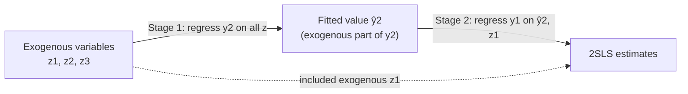
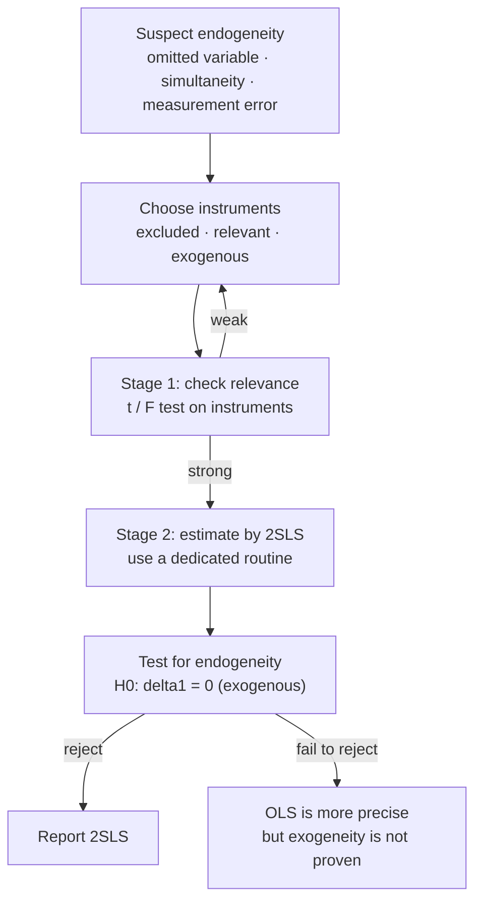

# Instrumental Variables & Two-Stage Least Squares (2SLS)

Study notes on Wooldridge, *Introductory Econometrics*, Chapter 15.
The notes follow the lecture slides and add the intuition emphasized in class.

**Contents**

1. [The problem: endogeneity](#1-the-problem-endogeneity)
2. [Instrumental variables](#2-instrumental-variables)
3. [Example 1: father's education as an IV](#3-example-1-fathers-education-as-an-iv)
4. [Weak and invalid instruments](#4-weak-and-invalid-instruments)
5. [IV in multiple regression](#5-iv-in-multiple-regression)
6. [Two-stage least squares](#6-two-stage-least-squares)
7. [Example 2: two instruments](#7-example-2-two-instruments)
8. [Measurement error](#8-measurement-error)
9. [Properties of 2SLS](#9-properties-of-2sls)
10. [Testing for endogeneity](#10-testing-for-endogeneity)
11. [Workflow summary](#11-workflow-summary)
12. [Key terms](#12-key-terms)

---

## 1. The problem: endogeneity

OLS needs the regressor to be uncorrelated with the error. When that fails, the regressor is **endogenous** and OLS is biased and inconsistent.

```math
y = \beta_0 + \beta_1 x + u, \qquad \mathrm{Cov}(x,u) \neq 0
```

```math
\operatorname{plim}\ \hat\beta_1^{OLS} = \beta_1 + \frac{\mathrm{Cov}(x,u)}{\mathrm{Var}(x)} \neq \beta_1
```

A larger sample does not help: the estimate converges to the wrong number.

### Three sources of endogeneity

| Source | Mechanism | Result |
|---|---|---|
| Omitted variable | Ability sits in the error and is correlated with education | $\mathrm{Cov}(x,u)\neq 0$ |
| Simultaneity (reverse causality) | $y=\beta_0+\beta_1 z+u$ and $z=\gamma_0+\gamma_1 y+v$ | $\mathrm{Cov}(z,u)=\dfrac{\gamma_1\mathrm{Var}(u)}{1-\gamma_1\beta_1}\neq 0$ |
| Measurement error | We observe $x=x^{\ast}+e$ instead of $x^{\ast}$ | Error becomes $u-\beta_1 e$, and $\mathrm{Cov}(x,\,u-\beta_1 e)=-\beta_1\sigma_e^2\neq 0$ |

Measurement error is the counter-intuitive one: a noisy regressor carries its own noise into the error term, so the two are correlated by construction.

### Why not the earlier fixes?

| Method | Limitation |
|---|---|
| Proxy variable | A good proxy is often unavailable |
| Fixed effects / first differencing | Needs panel data, a **time-constant** omitted variable, and a **time-varying** regressor of interest |
| **Instrumental variables** | General solution when the omitted variable cannot be included |

---

## 2. Instrumental variables

An instrument $z$ for the endogenous regressor $x$ must satisfy three conditions.

| # | Condition | Formal statement | Testable? |
|---|---|---|---|
| 1 | Exclusion | $z$ does not appear in the structural equation | By construction |
| 2 | Relevance | $\mathrm{Cov}(z,x)\neq 0$ | **Yes** — first-stage $t$ or $F$ test |
| 3 | Exogeneity | $\mathrm{Cov}(z,u)=0$ | **No** — must be argued from economics |

Relevance is checked with the first-stage regression:

```math
x = \pi_0 + \pi_1 z + v, \qquad H_0:\ \pi_1 = 0
```

### From the OLS formula to the IV formula

Take the covariance of both sides of the model with $z$:

```math
\mathrm{Cov}(z,y) = \beta_1\,\mathrm{Cov}(z,x) + \underbrace{\mathrm{Cov}(z,u)}_{=\,0}
\quad\Longrightarrow\quad
\beta_1 = \frac{\mathrm{Cov}(z,y)}{\mathrm{Cov}(z,x)}
```

| | Population | Sample estimator |
|---|---|---|
| OLS (exogenous $x$) | $\beta_1=\dfrac{\mathrm{Cov}(x,y)}{\mathrm{Var}(x)}$ | $\hat\beta_1=\dfrac{\sum(x_i-\bar x)(y_i-\bar y)}{\sum(x_i-\bar x)^2}$ |
| IV (endogenous $x$) | $\beta_1=\dfrac{\mathrm{Cov}(z,y)}{\mathrm{Cov}(z,x)}$ | $\hat\beta_1=\dfrac{\sum(z_i-\bar z)(y_i-\bar y)}{\sum(z_i-\bar z)(x_i-\bar x)}$ |

- The denominator must be non-zero. That is the relevance condition.
- Setting $z=x$ gives OLS back. OLS is the special case where $x$ is its own instrument.
- The IV estimator is consistent but not unbiased, so large samples are preferred.

### IV is less precise than OLS

```math
\mathrm{Var}(\hat\beta_1^{OLS}) = \frac{\sigma^2}{SST_x},
\qquad
\mathrm{Var}(\hat\beta_1^{IV}) = \frac{\sigma^2}{SST_x\cdot R^2_{x,z}}
```

Because $R^2_{x,z}<1$, the IV variance is always larger. The weaker the link between $x$ and $z$, the worse it gets.

Intuition: IV estimates two relationships in sequence (instrument → regressor → outcome), so uncertainty accumulates.

The $R^2$ after IV estimation can be negative and has no natural interpretation.

---

## 3. Example 1: father's education as an IV

Return to education for married working women (MROZ data, $n=428$).

| Model | Estimated equation | Note |
|---|---|---|
| OLS | $\widehat{\log(wage)} = -.185 + .109\ educ$ | SE on *educ*: .014 |
| First stage | $\widehat{educ} = 10.24 + .269\ fatheduc$ | SE: .029, $t\approx 9.28$ |
| IV | $\widehat{\log(wage)} = .441 + .059\ educ$ | SE on *educ*: .035 |

| | OLS | IV |
|---|---|---|
| Return to education | 10.9% | 5.9% |
| Standard error | .014 | .035 (2.5× larger) |

- The return falls by about half, consistent with omitted ability bias in OLS.
- Relevance holds ($t\approx 9.28$).
- Exogeneity is doubtful: educated, wealthier fathers can buy better schooling, and legacy admissions favor their children.
- Even so, an imperfect instrument that reduces omitted-variable bias can be better than no instrument.

### Other instruments for education in the literature

| Instrument | Why relevant | Why exogeneity is doubtful |
|---|---|---|
| Number of siblings | More siblings, less schooling per child | Wealthier families may have more children and invest more |
| College proximity | Living near a college lowers the cost of attending | Families in education-related jobs choose to live near colleges |
| Month (quarter) of birth | Compulsory schooling laws shift school entry age | Entering school too early or late may affect outcomes directly |

Truly exogenous instruments are hard to find. That does not make IV useless.

---

## 4. Weak and invalid instruments

```math
\operatorname{plim}\ \hat\beta_1^{IV} = \beta_1 + \frac{\mathrm{Corr}(z,u)}{\mathrm{Corr}(z,x)}\cdot\frac{\sigma_u}{\sigma_x}
```

```math
\operatorname{plim}\ \hat\beta_1^{OLS} = \beta_1 + \mathrm{Corr}(x,u)\cdot\frac{\sigma_u}{\sigma_x}
```

IV has a larger asymptotic bias than OLS when

```math
\frac{\mathrm{Corr}(z,u)}{\mathrm{Corr}(z,x)} > \mathrm{Corr}(x,u)
```

**Numerical example.** With $\mathrm{Corr}(z,u)=.03$, $\mathrm{Corr}(z,x)=.2$ and $\mathrm{Corr}(x,u)=.1$:

```math
\frac{.03}{.2} = .15 > .1 \quad\Rightarrow\quad \text{IV is worse than OLS}
```

**Read the formula, do not memorize it.**

| Part | Requirement | Intuition |
|---|---|---|
| Numerator $\mathrm{Corr}(z,u)$ | Zero, or very small | Any contamination of the instrument passes into the estimate |
| Denominator $\mathrm{Corr}(z,x)$ | Large | A big effect is easy to observe; a four-year gap in schooling is visible, a one-day gap is not |

A small denominator **amplifies** even a small violation of exogeneity. This is the weak-instrument problem.

---

## 5. IV in multiple regression

Notation: $y$ = endogenous, $z$ = exogenous.

**Structural equation**

```math
y_1 = \beta_0 + \beta_1 y_2 + \beta_2 z_1 + u_1
```

**Reduced form** (endogenous variable written in terms of all exogenous variables)

```math
y_2 = \pi_0 + \pi_1 z_1 + \pi_2 z_2 + v_2, \qquad \pi_2 \neq 0
```

- $z_1$ is already in the structural equation, so it cannot serve as the instrument. We need $z_2$ from outside the equation.
- $\pi_2\neq 0$ means $z_2$ is still correlated with $y_2$ after controlling for $z_1$. This identification condition can be tested with a $t$ test.

### Computing the estimates: method of moments

| | Conditions |
|---|---|
| Population | $E(u_1)=0,\quad \mathrm{Cov}(z_j,u_1)=0,\quad j=1,\dots,k$ |
| Sample | $\sum_i \hat u_i = 0,\quad \sum_i z_{ij}\hat u_i = 0$ |

Replace the error with the residual $\hat u_i = y_{i1}-\hat\beta_0-\hat\beta_1 y_{i2}-\hat\beta_2 z_{i1}-\dots$ and solve.
There are $k+1$ equations in $k+1$ unknowns. The solution is the IV estimate.
Included exogenous variables act as their own instruments.

---

## 6. Two-stage least squares

In practice, IV estimation is almost always done by 2SLS.



**Stage 1.** Regress the endogenous variable on *all* exogenous variables and keep the fitted values.

```math
y_2 = \pi_0 + \pi_1 z_1 + \pi_2 z_2 + \pi_3 z_3 + v_2 \quad\longrightarrow\quad \hat y_2
```

Identification requires rejecting $H_0:\pi_2=\pi_3=0$ with an $F$ test.

**Stage 2.** Regress $y_1$ on $\hat y_2$ and $z_1$.

```math
y_1 = \beta_0 + \beta_1 \hat y_2 + \beta_2 z_1 + error
```

### Why it works

Stage 1 splits $y_2$ into two pieces:

```math
y_2 = \underbrace{y_2^{\ast}}_{\text{exogenous part}} + \underbrace{v_2}_{\text{possibly endogenous part}},
\qquad y_2^{\ast} = \pi_0 + \pi_1 z_1 + \pi_2 z_2 + \pi_3 z_3
```

Substituting into the structural equation:

```math
y_1 = \beta_0 + \beta_1 y_2^{\ast} + \beta_2 z_1 + (u_1 + \beta_1 v_2)
```

The composite error is uncorrelated with $y_2^{\ast}$ and $z_1$. Stage 1 **purges** $y_2$ of its endogenous part, so OLS in stage 2 is valid.

### Three things to remember

| # | Point | Detail |
|---|---|---|
| 1 | Do not run stage 2 by hand | Coefficients are correct, **standard errors are wrong**: the error contains $v_2$, but the manual SE uses only $\mathrm{Var}(u_1)$. Use a dedicated 2SLS routine. |
| 2 | One endogenous variable, one instrument | 2SLS and IV give identical estimates |
| 3 | Several endogenous variables | **Order condition**: number of excluded exogenous variables ≥ number of included endogenous variables (necessary, not sufficient) |

---

## 7. Example 2: two instruments

Same data (MROZ, $n=428$), with mother's and father's education as instruments.

**Stage 1.** Regress *educ* on *exper*, *exper*², *motheduc*, *fatheduc*.
The test of $H_0:\pi_3=\pi_4=0$ gives $F=55.40$ ($p\approx 0$), so the parents' education variables are jointly relevant.

**Stage 2 (2SLS).**

```math
\widehat{\log(wage)} = \underset{(.400)}{.048} + \underset{(.031)}{.061}\,educ + \underset{(.013)}{.044}\,exper - \underset{(.0004)}{.0009}\,exper^2
```

| | OLS | 2SLS |
|---|---|---|
| Return to education | 10.8% | 6.1% |
| Precision | Tight | Larger SE; barely significant at 5% |

---

## 8. Measurement error

If the same variable is measured twice, the second measurement can instrument the first.

```math
x_1 = x_1^{\ast} + e_1, \qquad z_1 = x_1^{\ast} + a_1, \qquad \mathrm{Cov}(e_1,a_1)=0
```

- $z_1$ contains the same true value $x_1^{\ast}$, so it is correlated with $x_1$ (relevance).
- If the two measurement errors are uncorrelated, $z_1$ is uncorrelated with the composite error (exogeneity).
- Example: twins reporting each other's education.

A second measurement of the same variable is rarely available, so this problem is hard to fix in practice.

---

## 9. Properties of 2SLS

**Consistency and asymptotic normality.** The assumptions mirror those for OLS, stated conditional on the instruments $z$ rather than on $x$. The usual standard errors also need homoskedasticity, $E(u^2\mid z)=\sigma^2$.

**Lower precision.**

```math
\mathrm{Avar}(\hat\beta_1) \approx \frac{\sigma^2}{\widehat{SST}_2\,(1-\hat R_2^2)}
```

| Reason | Explanation |
|---|---|
| $\widehat{SST}_2$ is small | Fitted values $\hat y_2$ vary less than $y_2$ |
| $\hat R_2^2$ is large | $\hat y_2$ is highly correlated with the other exogenous variables (multicollinearity) |

**Extensions.**

| Setting | Handling |
|---|---|
| Heteroskedasticity, serial correlation | Robust standard errors, as with OLS |
| Time series, pooled cross sections | Same mechanics |
| Panel data | First differencing to remove the fixed effect, then IV for time-varying endogeneity |

---

## 10. Testing for endogeneity

If $y_2$ is actually exogenous, OLS is preferable because it is more precise. A regression-based test checks this.

**Step (i).** Estimate the reduced form and save the residuals.

```math
y_2 = \pi_0 + \pi_1 z_1 + \pi_2 z_2 + \pi_3 z_3 + v_2 \quad\longrightarrow\quad \hat v_2
```

**Step (ii).** Add the residuals to the structural equation and estimate by OLS.

```math
y_1 = \beta_0 + \beta_1 y_2 + \beta_2 z_1 + \delta_1 \hat v_2 + error, \qquad H_0:\ \delta_1 = 0
```

**Logic.** Write $u_1=\delta_1 v_2+e_1$. All of the possible endogeneity in $y_2$ is in $v_2$, so $y_2$ is exogenous if and only if $\delta_1=0$.

### Reading the result

| | Hypothesis |
|---|---|
| $H_0$ | $y_2$ is **exogenous** ($\delta_1=0$) |
| $H_1$ | $y_2$ is **endogenous** ($\delta_1\neq 0$) |

| Outcome | Conclusion |
|---|---|
| Significant | Reject exogeneity. Treat $y_2$ as endogenous and report 2SLS. |
| Not significant | Fail to reject. This does **not** prove exogeneity. |

Absence of evidence is not evidence of absence.

Applied to Example 2: $\hat\delta_1=.058$, $t=1.67$ — moderate evidence of endogeneity. A heteroskedasticity-robust $t$ test can be used as well.

---

## 11. Workflow summary



| Question | Check |
|---|---|
| Is the instrument relevant? | First-stage $t$ / $F$ |
| Is the instrument exogenous? | Not testable with one instrument per endogenous variable; argue it |
| Is the regressor endogenous? | Residual-inclusion test ($\delta_1$) |
| Are the standard errors right? | Only from a 2SLS routine, not from a manual second stage |

---

## 12. Key terms

| Term | Meaning |
|---|---|
| Endogenous explanatory variable | Regressor correlated with the error term |
| Instrumental variable (IV) | Variable excluded from the equation, correlated with the endogenous regressor, uncorrelated with the error |
| Instrument relevance | $\mathrm{Cov}(z,x)\neq 0$ |
| Instrument exogeneity | $\mathrm{Cov}(z,u)=0$ |
| Exclusion restriction | The instrument does not appear in the structural equation |
| Structural equation | The equation of interest, with a causal interpretation |
| Reduced form | Endogenous variable expressed in terms of exogenous variables only |
| Identification | The parameter can be written in terms of population moments that data can estimate |
| Two-stage least squares (2SLS) | IV estimator using the first-stage fitted value as the instrument |
| Order condition | At least as many excluded exogenous variables as included endogenous variables |
| Weak instruments | Instruments only weakly correlated with the endogenous regressor |
| Errors-in-variables | Regressor measured with error |

---

## Reference

Wooldridge, J. M. *Introductory Econometrics: A Modern Approach*, Chapter 15, "Instrumental Variables Estimation and Two Stage Least Squares." Numerical examples use the MROZ data set from the textbook.

These are personal study notes. Topics in the chapter that the lecture did not cover (overidentification tests, intention-to-treat with randomized eligibility) are omitted.
