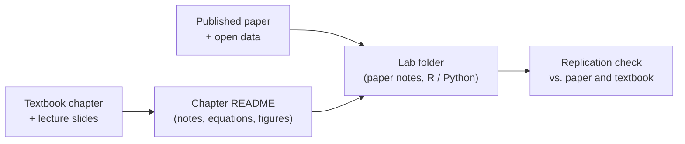

# Econometrics Notes

Study notes and code for an undergraduate econometrics course taught from Wooldridge, *Introductory Econometrics: A Modern Approach*. Each chapter folder pairs a written review with code that reproduces the numbers. Where the course worked with a published paper, there is an applied lab that replicates its results.

## Contents

| Folder | Topic | What's inside |
|---|---|---|
| [`Ch06-07/`](Ch06-07/) | Model selection, dummy variables, linear probability model | Notes · Python replication of textbook examples · 14 figures |
| [`Ch15/`](Ch15/) | Instrumental variables and two-stage least squares | Notes on endogeneity, IV, 2SLS, endogeneity and overidentification tests |
| [`Ch15/lab-overconfidence/`](Ch15/lab-overconfidence/) | **Applied lab:** IV in a negotiation experiment (Soldà et al., 2021) | Paper notes · R and Python code · replication of the paper's Table 2 · critique of the instruments |

## Layout

```
econometrics-notes/
├── README.md
├── Ch06-07/
│   ├── README.md            notes
│   ├── requirements.txt
│   ├── code/                replicate.py · make_figures.py
│   └── figures/
└── Ch15/
    ├── README.md            notes
    └── lab-overconfidence/
        ├── README.md        lab walkthrough
        ├── PAPER.md         reading notes on the paper
        ├── requirements.txt
        ├── data/            instruments.csv
        ├── code/            iv_lab.R · replicate.py · make_figures.py
        ├── figures/
        └── output/          R console output
```



## Running the code

```bash
# Chapter 6-7 (Python, textbook data from the `wooldridge` package)
pip install -r Ch06-07/requirements.txt
python Ch06-07/code/replicate.py

# Chapter 15 lab (R)
cd Ch15/lab-overconfidence/code && Rscript iv_lab.R      # needs install.packages(c("ivreg", "ivreg2r"))

# Chapter 15 lab (Python)
pip install -r Ch15/lab-overconfidence/requirements.txt
python Ch15/lab-overconfidence/code/replicate.py
```

## Notes

- Written in English; the course itself is taught in English with R in the lab sessions. Replications are written in Python as well so every number can be re-checked independently.
- These are personal study notes, not course materials. Textbook pages are not reproduced here.
